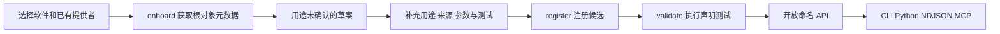

# 按软件注册功能 API

说明更新：2026-10-24。初版在现有 `appctl.objects/1` 上增加命名功能注册，提供 CLI、Python、NDJSON 和 MCP 出口。已有适配器能接入的软件通常只需增加提供者配置和功能清单；新的运行时仍需要接入适配器。

## 控件用途从哪里来

控件提供 `Invoke` 只能说明它支持激活动作；名称为“发送”，也不能单独确认发送对象、内容和完成条件。应组合证据：

| 证据 | 用途 | 局限 |
| --- | --- | --- |
| 名称、控件类型、帮助文字、标签和所在容器 | 判断元素角色及页面上下文 | 应用可能遗漏或错误填写；当前低层通道未采集所有可访问性字段 |
| 属性、方法签名、信号、框架操作模式 | 判断支持的动作和参数 | 不能自动说明业务前提、副作用和完整语义 |
| 官方文档、开发者清单、既有插件 | 提供业务说明及调用约定 | 需要记录来源和适用范围 |
| 独立状态下的调用前后对比、结果读回 | 验证特定条件下的实际行为 | 用例通过不能证明所有输入、页面和版本都正确 |

清单保留用途来源：`declared`、`documentation`、`inferred`、`observed`。来源是作者声明，并非自动证明。推测用途 `inferred` 不能直接验证和启用；需要先补充用途说明、参数、测试及来源。

## 当前没有覆盖全部可见内容

普通输入框、按钮和表格的部分信息可以通过对象、DOM 或可访问性接口取得。图片里的按钮、视频、自绘画布和未公开结构的区域，可能只能取得整体图像或外层容器。图像可以设计为 API 资源，但其中的元素并不会因此自动具有名称和可调用方法。

虚拟化列表和延迟创建的页面也不能靠一次遍历全部取得。可见不保证有结构化接口，能读取也不保证能写入。现有 Qt/C++ 原生观察快照仍不可调用，新注册层没有补出原生执行通道。

## 按需接入流程



框架执行规则与软件清单分开。不同软件有独立的 `app_id` 和功能 ID；新增无关提供者不会使既有软件的功能失效。

当前尚未监听系统安装事件、自动理解整套软件业务或自动发布全部功能。`onboard` 仅检查选定的一个根对象，草案上限为 256 个候选，并报告是否截断；更完整的对象探索继续使用 `objects explore`。

## 清单及执行规则

每个功能包含稳定 ID、名称、用途和来源，输入/输出 JSON Schema，声明的效果，明确的提供者与对象路径，测试参数和期望结果，以及可选的调用后状态检查。

注册和列举只读取配置，不启动软件。JSON Schema 仅接受本地引用，不获取远程 Schema。`onboard` 会启动明确选中的提供者来取得元数据，因此提供者初始化可能创建应用实例；这个阶段不执行属性 getter 或业务方法。已有草案不会被覆盖。

验证是独立的显式操作，会执行真实 getter/方法。当前入口仅接受声明的读操作，以及用 `--allow-write` 明确启用的写入测试；未知效果和外部操作不能在这里自动试运行。微信/QQ 发送没有因此接通。

通过后的状态是 `contract_validated`，只说明声明用例和当时的成员元数据通过检查，仍返回 `semantic_truth_proven=false`。执行时再次检查参数、成员元数据和声明的结果。结果不符、元数据变化或调用结果未知会撤下可调用标记，不自动重试。

所选提供者配置变化后需要重新注册、验证。软件升级若签名一致而行为变化，仍需回归测试；清单版本是作者记录，框架尚未自动校验所有二进制版本。

命名绑定支持路径上的 `get`/`call`，最后一步为 `get`、`set` 或 `call`，返回 JSON 值。复杂分支流程、长时事务、异步业务回执及 UIA/DOM 多步骤流程的命名绑定尚未实现。已有低层控件 API 继续独立可用。

## 已注册的工作区示例

| 软件命名空间 | 功能 | 范围 |
| --- | --- | --- |
| `counter-demo` | `counter.read` | 读取独立测试对象计数 |
| `counter-demo` | `counter.increment` | 增加计数并读回核对状态 |
| `windows-shell` | `drives.is-folder` | 通过真实 Shell 子对象链确认驱动器容器类型；只读 |

清单分别是 [counter-demo.json](capabilities/counter-demo.json) 和 [windows-shell.json](capabilities/windows-shell.json)。注册到项目内的 `capabilities.local.json`，没有修改系统服务或 AI 客户端全局配置。

2026-10-24 又注册并实测了微信的 `search.read/replace`，以及 QQ 的 `search.read/replace`、`draft.read/replace`，共六个功能。它们通过新的软件 profile 与显式运行时引导取得可执行字段，详见 [MESSENGERS.md](MESSENGERS.md)。QQ 草稿回读检查 ProseMirror 文档模型，两款软件均没有开放发送。

```powershell
python appctl.py capabilities --pretty list
python appctl.py capabilities --pretty describe --app windows-shell --capability drives.is-folder
python appctl.py capabilities invoke --app windows-shell --capability drives.is-folder
```

可用 `--registry` 或 `APPCTL_CAPABILITY_REGISTRY` 选择注册表。它保存清单及验证记录，不保存跨会话对象引用或原生地址。

## 接入新软件的命令

先在对象配置中定义提供者，再生成草案。以下对独立测试对象演示；输出路径必须尚不存在：

```powershell
python appctl.py capabilities onboard --config objects.example.json --target python-demo --root counter --app-id my-counter --output reports/my-counter-draft.json
```

草案的用途、参数约束和效果尚未确认。补充、删减后注册；不会自动启用候选功能：

```powershell
python appctl.py capabilities register reports/my-counter-draft.json
```

仓库中已有完整的测试清单，可以复现整条流程。重新注册会清除该软件先前的验证记录；测试应从独立对象的已知初始状态开始：

```powershell
python appctl.py capabilities --registry reports/counter-example-registry.json register capabilities/counter-demo.json
python appctl.py capabilities --registry reports/counter-example-registry.json validate --app counter-demo --capability counter.read
python appctl.py capabilities --registry reports/counter-example-registry.json validate --app counter-demo --capability counter.increment --allow-write
python appctl.py capabilities --registry reports/counter-example-registry.json invoke --app counter-demo --capability counter.increment --arguments '{"amount":3}'
```

单次 CLI 结束会关闭提供者连接，独立计数器下次命令会重新创建。需保留状态时使用 `capabilities session`、Python 类或 MCP。框架释放连接不会自动关闭用户应用。

## API 出口和验证

Python 使用 [CapabilityRegistry](capability_registry.py) 的 `register/list/describe/validate/invoke`，或 `request(op, args)`。NDJSON 使用 `python appctl.py capabilities session`。MCP 新增三个固定工具，通过动态注册表提供软件功能：

- `application_capabilities`：列举、搜索功能及参数类型。
- `application_capability_describe`：读取用途来源、绑定和验证范围。
- `application_capability_invoke`：调用通过声明用例验证的命名功能。

注册、验证和草案接入暂由 CLI/Python 完成，没有把界面文字直接当成新增工具或执行授权。依赖见 [requirements-capabilities.txt](requirements-capabilities.txt)；本机依赖已存在，没有安装软件。

早期注册层回归为 85 项，新增 QQ/微信运行时边界测试后的最新数量见 [object-validation.json](docs/VALIDATION.md)，MCP 工具仍为 28 个。真实 CLI/MCP 注册层验证还包括自动生成 10 个候选、候选拒绝、独立计数器状态读回、真实 Shell 对象链，见 [validation.json](https://github.com/daoxiang0520/GUI2API/blob/main/docs/VALIDATION.md)；QQ/微信的六个功能见 [integration.json](https://github.com/daoxiang0520/GUI2API/blob/main/docs/VALIDATION.md)。

接口依据：[UIA 属性](https://learn.microsoft.com/en-us/windows/win32/winauto/uiauto-automation-element-propids)、[UIA 控件模式](https://learn.microsoft.com/en-us/windows/win32/winauto/uiauto-controlpatternsoverview)、[虚拟化项目](https://learn.microsoft.com/en-us/windows/win32/winauto/uiauto-workingwithvirtualizeditems)、[Qt 元对象](https://doc.qt.io/qt-6/qmetaobject.html)。
