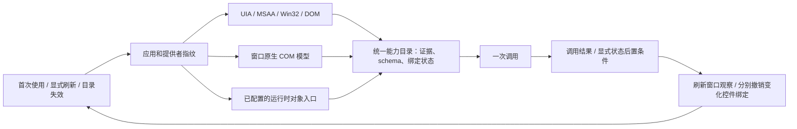

# 自动探索层

`DiscoveryManager` 把控件发现、运行时对象探索与现有命名能力登记接成一个目录，协议为 `appctl.discovery/1`，运行在现有 `GuiSession` 中。新软件不需要登记每一个按钮或业务功能；对象通道仍需软件实际暴露入口，或提供一次运行时桥配置。

**0.5.0 的当前契约见 [RELIABILITY.md](RELIABILITY.md)**：DSH/MCP/一次性 CLI 默认按控件聚合，含多个原始操作绑定、边界、父链指纹和唯一性；`layout='operations'` 提供兼容的方法列表。查询新增 exact/role/enabled/onscreen；零匹配不证明功能不存在。支持通用 GUI 后置校验、rebind 和显式窗口恢复。

## 执行流程



- `gui_find` 首次完整观察后自动建立控件能力目录。`discover(source)` 还会探测标准 `OBJID_NATIVEOM` 原生 COM 模型：限定当前窗口及同进程至多 15 个子窗口，不使用应用名、私有服务名或猜测的业务函数名，不启动目标应用。
- 已有 CDP DOM 来源沿用网页对象的发现与调用。`object_target` 自动对配置提供者枚举入口并运行同一个对象图探索器，覆盖 Python、JavaScript、.NET、Qt、COM。配置工厂可能启动其声明的程序；这与任意进程私有对象接入有区别。
- 默认不读取业务属性、不调用候选业务方法，也不根据 `get/list/search` 等名称猜测副作用。读取 GUI 标签、角色和边界属于控件观察；COM 握手和提供者初始化仍会运行各自的接口代码。
- 显式调用返回真实对象时，自动描述其元数据并将新成员加入当前目录，随后可以直接查询和调用；不会重做产生它的调用，也不会把普通 JSON 中形似引用的内容当成对象。对象参数可用 `object_arguments` 将参数索引映射到同一提供者的真实返回引用。
- 查询按名称、类型、角色、动作及提供者做元数据匹配。`discovery_describe` 返回完整参数 schema、签名、用途证据和绑定状态。名称匹配不证明业务含义。
- `callable=true` 表示存在执行绑定，仍需满足控件状态、焦点、参数等调用前提；它不保证业务成功。`callable=false` 的元数据条目会在调用前被拒绝。
- 原生 Qt5/MSVC x64 元数据探测需要显式 `native_metadata=true`。它在有超时的子进程中只读观察；得到的类型仍是 `callable=false`，不会调用原生地址。默认探测不使用 Electron 注入。
- 现有命名业务能力通过 `registered_app` 加入同一目录；只有已有契约验证仍有效的条目可调用。不会把探索到的名字自动提升为已验证业务命令。

## 调用

一次查看，进程退出后引用失效：

```powershell
python -X utf8 guictl.py discover --window 123456 --query "搜索"
python -X utf8 guictl.py --object-config objects.example.json discover --object-target python-demo
```

执行和持续复用应使用常驻会话：

```powershell
python -X utf8 guictl.py --object-config objects.example.json session
```

每行发送一个 JSON；下例中的标记均应替换为本会话真实返回的值：

```json
{"op":"discover","args":{"object_target":"python-demo","query":"add"}}
{"op":"discovery_describe","args":{"capability":"返回的 capability id"}}
{"op":"discovery_invoke","args":{"capability":"add 的 capability id","arguments":{"arguments":[3]},"postcondition":{"member":"count","equals":3}}}
```

控件条目的参数沿用其方法 schema；例如 `set` 使用 `{"value":"文本"}`，`scroll_input` 使用 `{"direction":"up","steps":3}`。对象方法使用 `{"arguments":[...]}`，对象属性写入使用 `{"value":...}`。属性 getter 也可能产生副作用，只有显式调用时才会执行。

MCP 和 DSH 都提供 `gui_discover`、`gui_discovery_describe`、`gui_discovery_invoke`、`gui_discovery_events`，以及增量学习、rebind、导入/导出和窗口恢复工具。DSH 插件源码版本为 **0.5.0**，当前共 28 个工具，含 4 个资源工具。现有本地 link 会在下次插件加载时读取新版，本次不修改 profile 或重启 Host。

## 缓存、失效与验证

当前会话保留真实来源、对象引用及控件标签；磁盘缓存只保存应用/配置/代码文件指纹、通道偏好、能力数量和 schema 哈希，不保存 PID、HWND、内存地址、会话引用、聊天文本或调用参数。默认位置为 `.cache/discovery.json`，可用 `GUI2API_DISCOVERY_CACHE` 或 CLI `--discovery-cache` 指定。

找到可用通道后，后续观察可优先使用该通道；失败、只有空结构或指定查询未命中时，扩展为多通道只读探测。显式 `refresh=true` 也重新探测。偏好是优化提示，不能证明其他通道没有控件。

已知 GUI 写操作将窗口观察标为陈旧，下一次目录调用先刷新元数据，仍匹配的控件操作保留 ID；删除、替换或改名的非编辑对象撤销相应绑定。失败的控件操作单独隔离。应用文件、进程或提供者变化仍可撤销整个来源。对象调用前再次检查元数据。窗口分离释放对应 COM 辅助进程，会话结束释放全部探索资源。

对象事件通过目录 `watch` 订阅，事件或丢失通知使对象目录失效。原生 GUI 从首次观察前监听 WinEvent，按窗口/PID 分流为不含值的变化序号。`discovery_events(catalog)` 返回 `needs_revalidation`，不将每次 GUI 事件变成全目录撤销；下一次查找刷新窗口观察。来源版本更换等导致目录替换时，旧 ID 仍返回 `stale_catalog`。

事件并不完整，观察缓存最长年龄为：监听健康 30 秒，其余来源 5 秒；`find.freshness` 报告策略。监听失败使观察需重建。普通引用仍由原提供者实时核对身份，不自动转绑或重放，最长有效 600 秒。管理器保留 32 个目录，每目录最多 4096 个聚合控件，方法数量单独统计；对象成员另限 4096 条。对象探索的数量、深度、请求数和时间预算保持有界，停止原因通过 `exploration` 返回。

调用返回仅表示该调用返回。可显式给对象调用增加同一对象属性的 `postcondition: {member, equals}`，只读取一次状态并比较，不会猜测业务后置条件。后置条件通过证明这个状态匹配，不证明任意异步业务完成，也不永久认证函数用途。失败或结果不明时不重放，不自动切换通道重做。

## 泛化验证与边界

验证脚本为 `verify_discovery.py`。运行时测试执行在项目创建的对象上；GUI 写操作执行在项目创建的窗口/本地网页上。现有 QQ、微信等真实程序只做发现和一次控件读取，不发送消息、不修改文档、不重启软件。结果与范围见 [本轮报告](https://github.com/daoxiang0520/GUI2API/blob/main/docs/VALIDATION.md)。

这层实现了自动发现、统一目录、确定绑定、缓存和失效重探。任意原生 C++ 实例的执行环境接入、通用调用链跟踪、GUI 操作与私有业务方法自动归因、HTTP OpenAPI 自动探测和通用业务语义认证尚未实现；当前探索也不会自动打开所有隐藏页面或遍历所有菜单。

保留原始快照及 0.3.1、0.4.0 等发布包。插件源码单独维护于 [dsh-winbot](https://github.com/daoxiang0520/dsh-winbot)，需同步更新配套 GUI2API 后端，本地 link 在下次插件加载时读取新版；不修改 profile 或重启 Host，见 [本轮记录](https://github.com/daoxiang0520/GUI2API/blob/main/docs/VALIDATION.md)。
