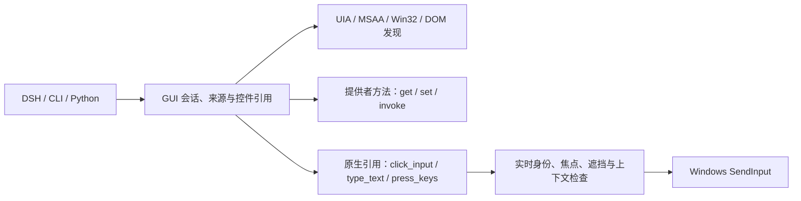

# 动态 GUI → API / CLI

多模态内容通过[资源接口](RESOURCES.md)关联 control_ref：resources 发现元数据，resource_describe 复核来源，resource_read 显式读取内容，resource_release 释放引用或清理文件。媒体节点存在、消息级分组、取得文件字节与模型理解是分别验证的能力。

本地绑定缓存支持单控件实时验证、缓存 rebind 和基于 ref 的定点后置校验，详见 [缓存与测速](CACHE.md)。目录执行可复用原始绑定；缓存失效时重新观察。

这层直接枚举当前软件暴露的界面对象，给每个对象生成方法和参数 schema，不要求先注册“搜索联系人”“播放音乐”等业务功能。协议是 `appctl.gui/1`，实现位于 `gui_api.py`、`gui_runtime.py` 和 `bridges/gui_dom.js`。旧的命名业务功能层仍可使用，但不是调用 GUI 的前提。

新增的[自动探索层](DISCOVERY.md)接入相同会话：`discover` 建立控件/业务对象目录，`discovery_describe` 查看 schema 与证据，`discovery_invoke` 调用绑定，`discovery_events` 读取原生 GUI 变化或已订阅的对象事件。首次 `find` 也会自动索引控件能力。旧的 `source/ref` 接口继续保留。

## 0.5.0：可靠性与目录生命周期

当前接口以 [RELIABILITY.md](RELIABILITY.md) 为准：一个控件保留多种原始绑定，身份不依赖名称，目录连续调用会刷新窗口观察并分别保留或撤销控件操作。支持 GUI postcondition、精确查询、rebind、候选导入/导出及窗口恢复。不可靠 MSAA/Qt invoke 默认先拦截，未证明业务效果时不重放。下方 0.4.0 及以前部分保留历史实现与验证，事件不再无条件撤销整个 GUI 目录。

## 0.4.0：使用时增量登记

正常扫描登记结构，正常 GUI 动作后的后续观察登记操作/序列关系，无需先穷尽应用页面。`find.learning` 返回当前状态与本次登记摘要；`learning_graph(source)` 查询累计关系和当前匹配。缓存记录不具有执行权限，名称只在实时界面中补充。详见 [接口、证据与持久化边界](LEARNING.md)。

## 0.3.1：事件失效与探测诊断

原生来源在首次观察前自动加入 `gui_events.py` 的 WinEvent 监听。一条进程外事件线程服务会话中的至多 64 个窗口来源，只保留来源变化序号，不保存事件文本、属性值或截图。窗口子控件的事件按根窗口和进程身份分流；光标、插入符和提示气泡对象的通知不触发刷新。相同窗口的多个来源有独立序号，分离来源会注销它，会话关闭停止线程。

外部 GUI 变化使观察与能力目录失效：旧目录的调用在执行前返回 `stale_capability`，下一次 `find` 重新观察。扫描前记录事件序号，因此扫描期间的变化也会触发后续刷新。普通控件 `ref` 仍绑定原对象，调用时沿用提供者的实时身份/状态校验；事件不会把引用转移到另一个同名对象，也不会重放动作。

`find` 返回 `freshness`。事件健康时缓存最长 30 秒，缺少监听时最长 5 秒；DOM/Electron 来源当前使用后者。事件不保证完整，显式 `refresh=true` 仍可用。`discovery_events(catalog)` 对原生 GUI 无需额外订阅，返回合并的变化提示；对运行时对象仍需先调用其 `watch` 能力。重建目录后应使用新 catalog，旧 catalog 返回 `stale_catalog`。控件/能力引用的 600 秒寿命与查询缓存寿命不同。

CDP 自动探测只检查所选窗口 PID 的监听端口，最多 8 个，按请求间检查的 2 秒预算限制；不重启应用、不扫描任意端口。失败结果区分 `cdp_not_discovered`、`cdp_probe_incomplete`、`ambiguous_target`，并给出范围、尝试和原因。“未发现”不能证明应用不支持 CDP，也不能证明只需补一个启动参数。已知入口可显式指定 endpoint/target；其他浏览器进程与跨页面归属尚未自动判断。

实窗验证覆盖独立通道修改 WinForms、Qt 窗口后的事件失效、旧能力拒绝和自动刷新，无截图；这是局部功能验证，未测量模型完成整项任务的耗时。结果见 [验证记录](https://github.com/daoxiang0520/GUI2API/blob/main/docs/VALIDATION.md)。

## 0.2.0：发现与输入分层



默认 `runtime=auto` 使用原生发现。`backend=auto` 可同时探测 UIA/MSAA/Win32；找到可用通道后可显式选 `backend=msaa/uia3/win32`，避免反复探测其他通道。`electron-dom` 保留为显式高级选项。

`click` 仍调用提供者的 `invoke`，`set_text` 仍调用提供者的 `set`。以下方法显式使用 OS 输入，不会在一个结果不明的动作之后自动切换通道重做：

| 方法 | 参数 | 行为 |
|---|---|---|
| `click_input` | `{button?: "left"或"right", guard_refs?: [...]}` | 从原控件重新取边界，在物理屏幕坐标中发送一次移动、按下和释放；默认左键 |
| `scroll_input` | `{direction: "up/down/left/right", steps?: 3, guard_refs?: [...]}` | 在当前前台窗口的控件实时边界内发送一次滚轮批次；steps 为 1..20 个刻度，不依赖 ScrollPattern |
| `type_text` | `{text, replace?: false, guard_refs?: [...]}` | 验证输入焦点后发送 Unicode；默认追加，`replace=true` 先 Ctrl+A；不隐含回车、不占用剪贴板 |
| `press_keys` | `{keys: "ENTER" 或 "CTRL+A", guard_refs?: [...]}` | 在已确认的控件焦点上发送一个按键组合 |

`guard_refs` 中的对象必须来自同一 GUI source，每次输入前验证其身份和观察时的名称、角色仍有效，适合绑定当前会话标题。输入被部分接受、焦点在输入中变化等返回 `outcome_unknown`，不会重放。真实输入使用交互桌面的前台焦点和鼠标，其他人或程序同时操作仍可能干扰；常驻 Bot 适合使用独立 VM/桌面。

名称是可变属性。QQ 搜索框会在聚焦后清空 placeholder 名称，编辑区发送后也可能变为空名。MSAA 对完整 COM 对象保留对象身份，对较弱的整数 child id 继续保守校验；需要名称不变时由 `guard_refs` 显式约束。只读查询复用快照，写操作将快照标为陈旧，下一次查询自动刷新。真正 `stale_ref` 必须重新发现，不能对旧引用循环调用。

MSAA 支持 0..100 层有界遍历，UIA/Win32 各自限制到 20 层，并报告深度/节点/时间边界。此前统一截在 20 层会漏掉 QQ 深层消息文字。原生字段延迟发布时只轮询回读，绝不重复 setter。坐标处理遵循微软的 [UIA 缩放说明](https://learn.microsoft.com/en-us/windows/win32/winauto/uiauto-screenscaling)。

本轮通过真实 DSH 工具管线，使用原生 MSAA/SendInput 向“示例联系人”发送唯一标记 `G2A-example`，随后只读确认文本在聊天记录中出现、编辑区为空、发送按钮禁用。没有截图或 Electron 注入，见 [实测记录](https://github.com/daoxiang0520/GUI2API/blob/main/docs/VALIDATION.md)。以下 Electron 示例与旧测试结果保留为历史通道说明。

## 直接调用控件对象

新增 `gui_controls.py`，可把扫描结果直接作为控件对象使用。下面的操作已经在当前 QQ 验证，点击联系人后可以点击消息返回：

```python
from gui_controls import GUI

with GUI() as gui:
    window = gui.window(app='QQ', title='QQ', runtime='electron-dom', api_module='QQNT.dll')
    window.one(name='联系人', role='Button').click()
    window.refresh()
    window.one(name='消息', role='Button').click()
```

其他控件使用相同方法，例如 `textbox.text = 'hello'`、`checkbox.check()`、`item.select()`、`tab.click()`、`pane.scroll('down')`。`window.controls()` 列出对象，`window.one()` 按名称、角色、ID、方法和后端筛选唯一对象；歧义不会自动点击。首次发现后缓存元数据，纯查询复用观察；写操作后下一次查询自动刷新，外部布局变化可显式 `refresh()`。原生多通道可能返回同名对象，必要时用 `backend='uia3'` 等条件限定。

这些是普通控件操作包装，不调用命名业务注册表，不需要分析事件处理函数。`click()` 在提供者调用返回时就返回，`executed_unverified` 也属于正常调用返回；后续业务结果不属于点击接口的成功前提。输入仍保留提供者的字段回读信息，`expected` 是可选的比较条件。

2026-10-24 新实测：QQ 成功切换联系人再返回消息页面，原编辑器对象保留；普通 Qt5 窗口完成按钮、输入、勾选、列表选择和标签页点击；Chromium 本地页面完成同一组控件对象操作，并覆盖展开、滚动和子页面输入。Qt5 提供者没有暴露树节点展开/折叠，这项未实现。实测脚本为 `verify_control_objects.py`，报告位于 `reports/control-objects-20261024/`。全程无截图、无消息发送。

## 调用方式

```powershell
python -m pip install -r requirements-gui.txt
python guictl.py schema
python guictl.py apps
python guictl.py session
```

会话每行收发一条 JSON；`source` 和 `ref` 必须使用本会话实际返回的值：

也可直接使用短操作名，例如 `{"op":"click","args":{"ref":"实际返回的ref"}}`、`{"op":"set_text","args":{"ref":"实际返回的ref","text":"hello"}}`。还支持 `read_text/select/check/uncheck/expand/collapse/scroll/focus`；`schema` 返回它们与底层方法的对应关系。

```json
{"id":1,"op":"attach","args":{"runtime":"native","window":123456}}
{"id":2,"op":"scan","args":{"source":"返回的source","limit":300}}
{"id":3,"op":"describe","args":{"ref":"返回的控件ref"}}
{"id":4,"op":"call","args":{"ref":"返回的控件ref","method":"get"}}
{"id":5,"op":"call","args":{"ref":"返回的输入框ref","method":"set","arguments":{"value":"hello","expected":""}}}
{"id":6,"op":"call","args":{"ref":"返回的按钮ref","method":"invoke"}}
{"id":7,"op":"detach","args":{"source":"返回的source"}}
{"id":8,"op":"close"}
```

Python 示例只读取当前窗口的元数据：

```python
from gui_api import GuiSession

def ok(result):
    if not result['ok']:
        raise RuntimeError(result['error'])
    return result['data']

with GuiSession() as gui:
    windows = ok(gui.request('apps'))['windows']
    window = next(w for w in windows if w['app'].casefold() == 'cloudmusic')
    source = ok(gui.request('attach', {'window': window['window']}))['source']
    page = ok(gui.request('scan', {'source': source}))
    for node in page['elements']:
        print(node['ref'], node['role'], node['name'], node['methods'])
    # cursor 非空时继续 scan；root_ref 可用于缩小到某个子树。
```

MCP 服务 `python appctl_mcp.py` 保留现有工具，并增加 `gui_resources`、`gui_resource_describe`、`gui_resource_read`、`gui_resource_release`，当前共 48 个工具。

`find/gui_find` 先补齐有界观察的分页，再在缓存中按名称、角色、ID、类名搜索词、方法、启用/离屏状态和 `within_ref` 后代范围筛选；不读取控件值。默认紧凑返回，`refresh=true` 更新观察，`offset/limit` 分页筛选结果，`collection_truncated` 描述提供者的采集边界。Python `controls()` 使用相同匹配规则；字符串匹配不区分大小写。`gui_invoke` 同时接受 `click/read_text/set_text/check/uncheck` 等短操作名。

一次性 CLI 可使用 `python guictl.py inspect --window 123456 --method click`；输出引用在该进程退出后失效。`python guictl.py targets --endpoint http://127.0.0.1:9222` 可枚举已有 CDP 页面。常驻会话的格式错误保留请求 ID 并返回结构化错误，`close` 为幂等操作。

## 框架适配与软件特化的区别

| 通道 | 连接参数 | 连接后如何发现功能 |
|---|---|---|
| `native` | 当前 HWND | 原始 UIA 控件树，加 MSAA、Win32；不写软件功能清单 |
| `cdp-dom` | 已存在的本机 CDP endpoint 和精确 target | 通用 DOM 遍历，包含开放 Shadow DOM、同源 iframe |
| `electron-dom` | HWND；部分宿主还需要 `api_module` | 与浏览器使用同一份 `gui_dom.js`；无 QQ CSS 选择器或字段名 |
| `wechat-qt` | HWND | 当前版本专用的可访问性启动，再执行通用原始 UIA 遍历 |

因此，“枚举、描述和调用控件”已能跨应用复用；“进入应用运行时”仍有框架和版本差异。当前微信启动方式仍是特化，不能推广成任意 Qt 软件都支持该启动方式。QQ 当前连接例子是 `runtime=electron-dom, api_module=QQNT.dll`；其他 Electron 宿主可能从主模块导出 Node-API，或不支持这条启动通道。WebView2、CEF、Java 和无可访问性的自绘程序没有因这次改动就全部接通。

Electron 通道需额外安装 `requirements-messengers.txt`，会注入本地 Node-API 桥并加载本地构建的 addon；addon 在应用退出前保留在模块缓存。首次连接可能短暂还原最小化窗口，释放时恢复。微信通道只对已校验版本启用一个可访问性数据字节，正常释放时恢复原值。`detach` 返回实际清理结果，不改变应用登录状态。

## 每个控件能提供什么

扫描返回 `ref`、父节点、名称及来源、角色、类名、ID、可用状态、方法、来源和缺口。`describe(ref)` 返回该控件实际声明的方法 schema：`get / set / invoke / focus / select / toggle-on / toggle-off / expand / collapse / scroll` 的适用子集。

DOM 中普通 div 也可能通过事件委托响应点击，因此有 `click()` 的节点可暴露 `invoke`；这不代表它具有独立业务功能。输入只对原生值控件和真正的编辑宿主提供 `set`，继承 `contenteditable` 的子段落不重复提供写接口。识别到 ProseMirror 时回读文档模型；替换富文本草稿仍会拒绝。

DOM 点击属于程序调用 `element.click()`，不等同于受信任的鼠标事件；有的程序会忽略它。当前没有把任意拖拽、画布内部命中测试、文本范围编辑和所有控件特有模式都封装完整。因此，枚举出对象仍不表示每一种人类交互都已提供 API。

名称、role、label 和类名是理解用途的线索，不是功能语义的证明。图标按钮或无标签控件仍可能需要应用知识。`capability_state=advertised` 表示提供者声明的方法；微信 Qt 提供者甚至会对大量非输入控件声明 ValuePattern，因此不能把声明数量当成有效功能数量。

`set` 支持 `expected` 以避免覆盖已变化的文本。DOM 在同一次回调中比较后写入；原生 UIA 是先比较再调用，不能承诺跨进程原子性。字段回读成功返回 `verified`；点击通常返回 `executed_unverified`，应再次观察结果，不能直接宣称消息已发出或任务已完成。调用不跨通道重试，不凭名称重新猜测目标。页面跳转、节点销毁、连接更换或释放会拒绝失效引用；引用最长保留十分钟。

## “全部扒出”的范围

当前会话可以分页拿到**本次收集到的全部对象**。下一页复用快照，不重新遍历应用。DOM 默认省略没有布局的节点，`include_hidden=true` 可枚举已实例化的隐藏节点；原生 raw view 保留提供者返回的非可见节点。`cursor=null` 只表示快照已取完；`truncated=true` 表示提供者已报告收集受限，需要缩小子树再查。原生 UIA 的深度上限为 20，DOM 可配置至 100；各通道还存在节点/时间预算。原生结果附带 `collection_bounds`；提供者可能在深度边界停止而未计数更深后代，所以 `truncated=false` 也不证明更深处没有控件。

这仍不等于整款软件的全部功能：未打开的对话框、未加载的页面、虚拟列表中尚未创建的项、封闭 Shadow DOM、跨源 iframe、canvas/视频内部只有像素的元素，可能没有可枚举对象。DOM 对 canvas 和不可访问子页面返回缺口。后续打开菜单或切换页面后，需要重新扫描当前状态。节点计数可能包含容器和多通道重复表示。

微软的 [UIA 原始视图说明](https://learn.microsoft.com/en-us/windows/win32/winauto/uiauto-treeoverview)和[虚拟化控件说明](https://learn.microsoft.com/en-us/windows/win32/winauto/uiauto-workingwithvirtualizeditems)解释了这类边界。Electron 传输使用其 [webContents.executeJavaScript](https://www.electronjs.org/docs/latest/api/web-contents/) 接口，公共 API 只接收固定操作和 JSON 参数，不开放任意代码执行。

## 2026-10-24 实测

| 实际窗口/宿主 | 采集节点 | 验证范围 |
|---|---:|---|
| QQ | 1004 | 通用 DOM 遍历；搜索输入、编辑器纯文本写入/模型回读/恢复，无功能 profile |
| 微信 | 143 | raw UIA 遍历；两个当时为空的 Edit 写入/回读/恢复，未验证会话导航或发送 |
| 网易云音乐 | 478 | 通用原生枚举，仅元数据 |
| 资源管理器 | 1011 | 通用原生枚举；MCP 完成节点读取 |
| IDA | 370 | 通用原生枚举，仅元数据 |
| VS Code | 884 | 当前原始控件树的元数据；未验证完整 workbench 操作 |
| WebSocket Reflector X | 9 | 当前只取得窗口结构，不能算应用功能已接通 |
| Chrome / Edge 独立测试页 | 33 / 33 | 同一 DOM 引擎，文本事件闭环、按钮回读、选择/勾选/展开/滚动、事件委托、Shadow DOM、iframe、引用失效与分页 |
| WinForms 自建程序 | 156 | 标准输入/按钮、MSAA 自绘输入/按钮/复选框，逐项验证实际状态变化 |

浏览器使用自建本地页面、单独用户目录；真实应用未进行任意按钮遍历。QQ/微信的文本标记均已清除，未发送消息。首次连接和完整分页采集耗时包含桥启动与多次请求，不是单次控件调用延迟，也没有截图方案的对照测试。

复现原始通道测试：`python verify_gui.py --case browsers`、`--case native`、`--case live`、`--case mcp`。结果位于 `reports/gui-surface-20261024/`。

直接控件包装复现：`python verify_control_objects.py --case qt`、`--case web`、`--case qq`。CLI/MCP 的真实控件调用测试分别是 `python tests/smoke_control_cli.py`、`python tests/smoke_control_mcp.py`，报告位于 `reports/control-objects-20261024/`。最新完整单元回归由 `verify_objects.py` 执行，并记录在 `object-validation.json` 的 `unit_tests` 字段中。
